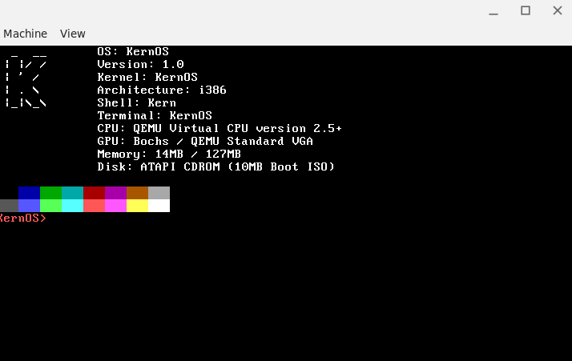
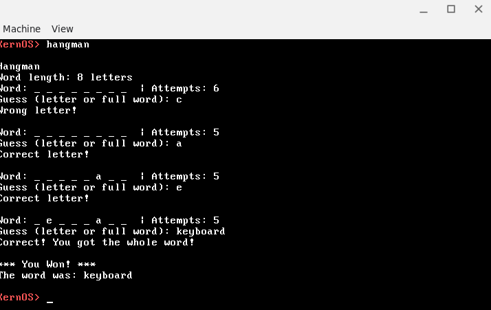
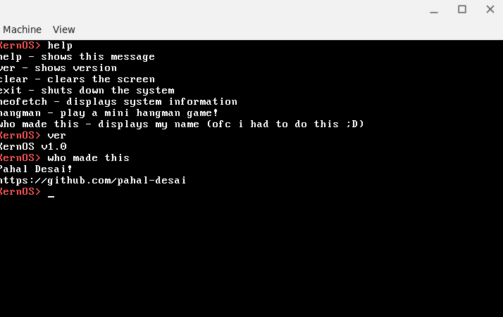

# KernOS
This is a tiny x86 hobby operating system written in C and Assembly.

## Features
* It has runs basic commands like neofetch, ver, clear, help, and an easter egg command.
* It has a mini game too (hangman).

## why i made this??!!
just for fun -_-
I wanted to learn assembly and more on how operating systems work. That's why i started this project.
And i was heavily inspired by the story of temple os.

## What features i want to add in future??
* have some basic terminal keyboard shortcuts (like ctrl+c to inturrupt, up arrow key to get previous commands, etc)
* create/delete/edit files
* run a video game (doom to be precise :D)

## How to run?

### 1. Windows

**Step 1: Install QEMU**

Open PowerShell and run:

```powershell
winget install QEMU
```

**Step 2: Download KernOS**

Download `kernos.iso` from the [Releases](https://github.com/pahal-desai/kernel/releases) page.

**Step 3: Run KernOS**

Open PowerShell in the directory containing `kernos.iso` and run:

```powershell
qemu-system-i386 -cdrom kernos.iso -device isa-debug-exit,iobase=0xf4,iosize=0x04
```

---

### 2. Linux

**Run this simple shell script**
```bash
curl -fsSL https://raw.githubusercontent.com/pahal-desai/kernel/main/run-kernos.sh | bash
```
It detects your distro, downloads qemu, downloads kernos and runs it using qemu
### 3. macOS

**Step 1: Install Homebrew**

If you don't have Homebrew installed, follow the instructions at [brew.sh](https://brew.sh/).

**Step 2: Install QEMU**

Open Terminal and run:

```bash
brew install qemu
```

**Step 3: Download KernOS**

Download `kernos.iso` from the [Releases](https://github.com/pahal-desai/kernel/releases) page.

**Step 4: Run KernOS**

Open a terminal in the directory containing `kernos.iso` and run:

```bash
qemu-system-i386 -cdrom kernos.iso -device isa-debug-exit,iobase=0xf4,iosize=0x04
```


## Screenshots:-
* neofetch



* hangman



* other commands



* shutdown


